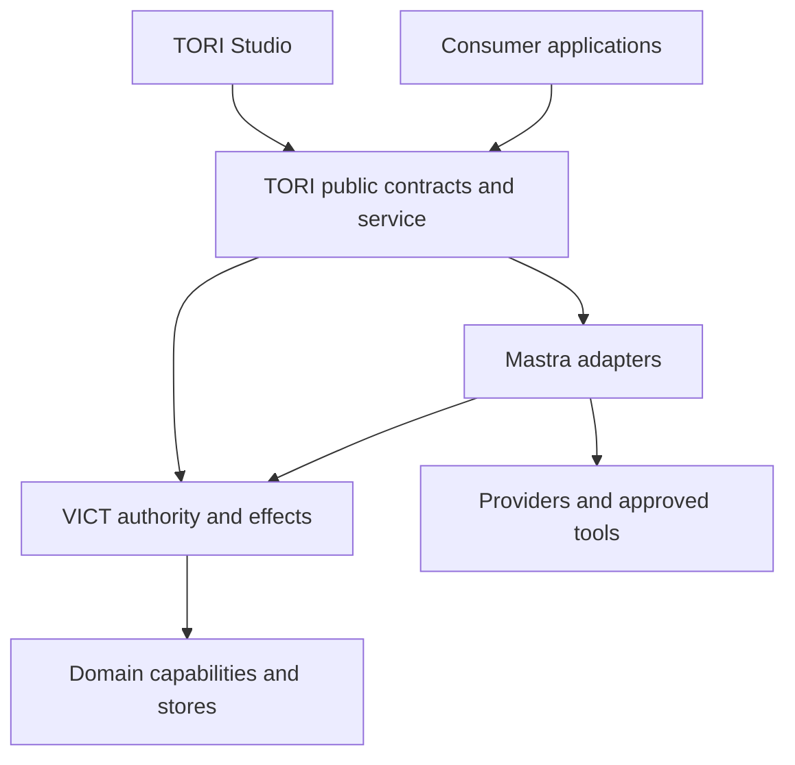

# TORI architecture and ownership

This document specifies boundaries. Concrete module names below are proposed until G0 confirms packaging. Existing VICT serialized contracts and public APIs take precedence over illustrative TORI names.

## Dependency direction

The diagram expresses logical ownership, not a requirement for six network services. TORI should begin with the smallest deployable host that preserves these boundaries. Browser clients never receive provider secrets or direct unrestricted Mastra tool authority.

## Logical code boundaries

| Proposed location | Responsibility | Must not own |
| --- | --- | --- |
| `apps/studio` | Routes, screen composition, view state, VICT control integration and host launch | A private agent runtime or the only implementation of reusable operations |
| `packages/contracts` | TORI-specific DTOs/ports/extensions and compatibility metadata that VICT does not already provide | Copies of canonical VICT schemas |
| `packages/core` | Shared catalog resolution, mappings and orchestration of existing services | A new agent loop, workflow engine, or credential vault |
| `packages/adapters-vict` | Public VICT definition/activation/effect/authoring binding | Unchecked access to VICT internals or duplicated effect ledger |
| `packages/adapters-mastra` | Exact-version supported primitives bound to VICT policy | New authority, implicit tools or unmanaged side effects |
| `packages/ui` | Reusable TORI-specific compositions only when more than one host needs them | A fork of VICT controls, graph editor, themes or interaction primitives |
| `packages/adapters-simulated` | Deterministic scenario behavior for U0 and offline verification | Secret access, network tools, or live run status |
| `examples/consumer` | Minimal independent client of built public artifacts | Studio source imports |

Create only the packages a slice needs. A folder structure is not a publication plan; package names, versioning, registry and license are decided separately. General VICT improvements belong upstream through a scoped dependency change, rather than a permanent TORI-local copy.

## Definition authority and projections

1. Author a draft using VICT's source/edit/history capabilities.
2. Validate domain configuration and graph semantics. Preserve stable IDs and explicit revision relationships.
3. Save a new definition revision through the chosen VICT-compatible store boundary.
4. VICT resolves and validates the requested revision into an immutable activation, including allowed capability and child references.
5. TORI binds the activation to the selected Mastra mechanisms and session/run policy.
6. Execution emits safe evidence; the Studio projects it as Trace and Session activity.

Graph coordinates, inspector state and node rendering are projections/presentation state. A rendered edge is not automatically an executable edge. G0 must record how `vict.flow-graph@3` editing data maps to agent, AI workflow, VICT business graph, or creative definitions. Do not put arbitrary TORI fields into strict upstream schemas.

## Storage ownership

| Data | Authority / persistence |
| --- | --- |
| Definitions, revisions, activations | Existing VICT contracts; TORI records references and adapters |
| Conversation and supported agent memory | Mastra stores with VICT actor/project scope |
| TORI Session identity and bindings | Durable TORI association to actor/project, activation, thread, runs and settings |
| Live controller state | Mastra live session; reconstruct only what is proven safe from durable records |
| Protected effects and approvals | VICT control/effect records; never a second authoritative TORI ledger |
| Application tasks, commitments, knowledge records | Owning application capabilities/store |
| Artifacts | Stable metadata/version/provenance; byte storage via selected managed store adapter |
| UI state | Explicit local/project preference scope; never authorization |
| Credentials | Server-side approved secret store/provider flow; frontend receives safe descriptors only |

A persistent thread does not guarantee persistence of pending approvals, session grants, arbitrary state, or active runs. TORI must explicitly map and verify recovery. An interrupted operation may be reported interrupted/uncertain rather than “resumed” if its adapter cannot safely continue.

## Four critical enforcement boundaries

**Trusted context.** Actor, project, consumer identity and resource scopes originate at the authenticated server boundary. Prompts, tool responses, graph labels, and request-body actor IDs cannot override them.

**Tools.** Resolve visibility from the catalog, intersect it with activation and current actor policy, then validate again on execution. Discovery and permission are separate. Revocation must affect subsequent calls even if a tool remains cached in model context.

**Child agents.** Pin child definition identities, constrain tool/data/workspace access and budgets, correlate runs, and define cancellation. Delegation cannot widen the parent's allowed authority unless the existing VICT model explicitly authorizes an independent principal.

**Workspaces/external harnesses.** Path labels and UI permissions are not OS containment. Shell, ACP and external browser processes need enforceable isolation and an honest audit boundary. Do not claim per-file/per-command approval for actions performed invisibly inside another harness.

## Service exposure and consumption

Studio and external applications call the same service operations. Use the VICT server/app command envelope where suitable; choose an extension only after mapping the existing operations. Transport may be HTTP with streamed events, an in-process client, or a later MCP facade; transport does not create a separate authority model. Expose the complete shared operation set programmatically, with capability negotiation and explicit unsupported responses.

Prove reuse through a minimal installed consumer before declaring reusable delivery, and through real Quellight/coding acceptance at V5. Do not force Quellight's business logic into TORI just to make the headless test easy.

## Compatibility policy

Pin source, lockfile and artifact identities. Preserve strict `vict.agent-stream@1` semantics. Child/background/reasoning extensions need a versioned companion projection or explicitly supported additive contract, not undocumented extra fields.

Discover providers' model features at the supported boundary; cache with freshness and authorization scope. Unknown costs remain unknown. Use exact pinned Mastra conformance probes before promising Controller, Skills, schedules, goals, or durable recovery. Upgrading a package to make an example compile is a dependency decision with regression evidence.

## Deployment boundaries

U0 needs an independent local Studio with a separate data directory and port. Avoid changes to the running VICT Studio or its assets. Subsequent deployment should support a reusable service consumed by Studio and apps; select local/remote hosting and secret-storage arrangements when those integrations are actually implemented.

For the owner's Windows environment, provide Windows-compatible launch instructions and a reproducible portable install. Do not bake this assistant's scratch paths or another project's local directories into the product.
