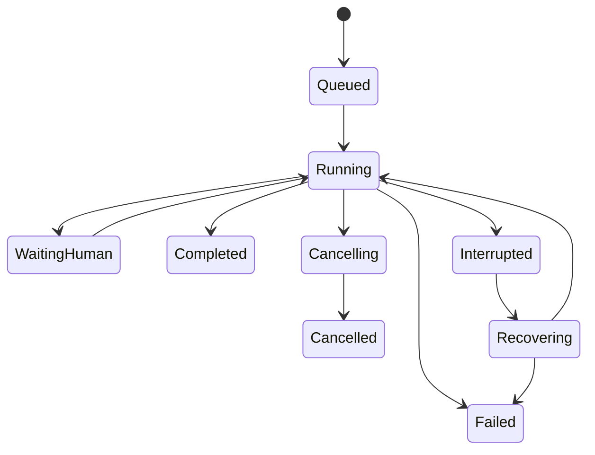

# Minimum contracts and invariants

This is a normative behavior contract with **proposed logical DTO names**, not shipped TypeScript APIs. G0 must map each item to VICT/Mastra public types before implementation. Reuse upstream types and references; introduce a versioned TORI extension only for a genuine gap. Do not loosen a strict VICT schema by attaching arbitrary fields.

## 1. Identities and relationships

| Object | Minimum logical data | Invariants |
| --- | --- | --- |
| Definition | ID, kind, schema revision, owner/project, draft revision, source refs, title, configuration, validation | Editing creates/revises a draft; valid JSON alone does not imply executable validity |
| Definition revision | Exact immutable revision reference, content identity, dependency references | Run provenance resolves this version, never “latest” |
| Activation | VICT activation reference, resolved definition refs, granted capabilities/models/data scopes, compatibility | Created through VICT validation/authority; immutable; UI cannot forge execution permission |
| Session | Stable ID, actor/project/consumer, thread binding, participant refs, selected activation/model/mode, run/artifact refs | Survives navigation; durable identity is separate from live Mastra Session |
| Run | ID, session/activation refs, parent/child refs, attempt ID, status, input refs, timestamps, result/artifact refs | Bound to exact configuration and actual provider/model; terminal outcomes cannot be overwritten by late events |
| Graph | Definition/revision ref, graph kind, typed nodes/ports/edges, presentation refs | Layout and executable relationships are distinguishable; stable IDs survive navigation/editing |
| Artifact | ID/version, media type, byte-store reference/hash, owner/scope, inputs/operator/run refs, lifecycle | Old versions are retained; missing bytes are explicit; metadata is not proof bytes exist |
| Connection | ID, provider/type, safe account label, credential reference, capabilities, status | No raw secret in browser DTO, definition export, trace or fixture |
| Human request | ID, run/activation/actor scope, kind, payload schema, revision/expiry, resolution | Clarification/plan review/effect approval are separate kinds; stale/duplicate responses cannot repeat effects |
| Capability descriptor | Stable ID/revision, schemas, owner, permissions/effects, adapter support, authoring recipe | Discovery does not confer authority |

Keep app record IDs as references. A Quellight commitment remains a Quellight record, even when an agent discusses it or a TORI goal refers to it.

## 2. Graph and port semantics

Every connection carries an explicit relationship kind and schema. The initial semantic families below are requirements for clarity, not a final node taxonomy:

| Relationship | Meaning | Validation |
| --- | --- | --- |
| Tool availability | Agent may request a configured tool | Declared capability/activation scope; no permission granted by edge creation |
| Delegation | Agent may invoke a pinned child under policy | Child identity, cycles/depth policy, authority intersection, budgets |
| Typed data | Value/artifact output feeds an input | Direction, schema/type, requiredness, cardinality and compatible version |
| Control | Ordering, branch, join, wait/review | Supported execution model, valid targets, reachable outputs, explicit cycle/loop policy |
| Context/reference | Informational connection between resources/cards | Access scope, resolvable reference; never executed automatically |
| Provenance | Result derived from particular inputs/run/version | Recorded from actual production of output; cannot pretend a manually linked asset was generated |

Typed ports include stable ID, label, direction, schema reference, cardinality, optionality and supported artifact/media constraints. Do not treat every string as compatible or infer runtime types from node titles/colors. Reject dangling references, missing required inputs, incompatible ports and unsupported execution cycles with actionable node/port-specific diagnostics. Informational cycles may be valid; executable loop policies are explicit.

Changing upstream inputs creates a new revision and marks affected downstream results stale. Existing artifacts remain inspectable. A partial rerun records exactly which node revisions and inputs were reused; no new run is silently credited with older output.

Creative-to-workflow conversion is an explicit operation: user chooses executable operators/ports, validates typed boundaries, and preserves branch/artifact identity. The system must not interpret every creative link as a runnable dependency.

## 3. Authoring transactions and persistence

Use VICT transaction/history and revision/occurrence protections. Each edit has expected source revision and applicable node/occurrence identity. Multi-property operations are atomic where the public contract supports them. A stale edit is rejected or presented for reconciliation, never applied over newer manual work.

Undo/Redo affects authoring transactions. Undo does not undo an already-executed external side effect. Explain this difference when a result has already been created. Persist saved definitions, layout, relevant inspector selections/preferences and artifact references; choose explicit scopes for UI state.

U0 must select and document a real local durable store. Reuse `DocumentStorePort`/`EditorBridge` or the appropriate public VICT boundary. Same-browser persistence may be sufficient for U0 if storage lifetime, quota, export/recovery and lack of cross-device sync are explicit. It is not evidence of service/database durability. Storage failure must leave an unsaved indicator and preserve the user's draft. A successful Save means a reloadable committed revision.

Test two writers against the same definition. Do not use last-writer-wins silently. Export/import must carry schema/compatibility and artifact references; partial or corrupt imports must not erase existing work. If bytes are external, report unresolved assets and preserve the original project.

## 4. Public service operation families

Names below are logical groupings; bind to existing VICT commands where possible.

| Family | Required operations | Contract notes |
| --- | --- | --- |
| Definitions | List/get/create/clone/edit/validate/save/revision history/retire | Expected revision, typed diagnostics, stable identities |
| Activation | Resolve/validate/activate/get provenance | Server authority, exact refs, atomic snapshot |
| Catalog | List/search/get/availability/compatibility | Actor-scoped visibility; unsupported reason |
| Connections/models | Start/complete supported auth, status/disconnect, model discovery/defaults | Secrets server-side; capability discovery does not assume all models support all modalities |
| Sessions | Create/list/reopen/select activation/set permitted mode/model/participants | Explicit turn-boundary selection, preserved conversation |
| Runs | Start/get/subscribe/cancel/reconcile/resume if supported | Idempotent submission, ownership, errors/uncertainty, no hidden run on reconnect |
| Human interaction | Get requests/respond/withdraw/expire | Trusted identity, revision/expiry, distinction from effect approval |
| Artifacts | Register/read metadata/list versions/resolve bytes/lineage | Access checks per read; integrity, provenance and retention |
| Evaluation | Cases/datasets/experiment/run/compare | Versioned input/config/scorer; deterministic vs live evidence |
| Automation | Schedule CRUD/pause/resume/trigger, signals/inbox/goals | Timezone/misfire policy, deduplication and scoped authority |
| Consumer operations | Discover/query/mutate/action via app boundary | Same domain authorization and durable result as the app |

All operations receive trusted context from the server, return typed outcomes, and expose correlation/request IDs. Mutations use expected revisions and operation IDs when applicable. Repeated requests may reattach/read a prior result rather than create a second run/effect. Cancellation is a request with an observed outcome, not a guarantee that a remote side effect has been reversed.

Proposed typed error categories: invalid input, stale revision, unauthorized, capability unavailable, unsupported version, provider unavailable, budget exceeded, cancelled, interrupted, uncertain effect, storage failure. Adapt to existing VICT codes instead of duplicating them. Do not hide raw HTML/transport failures behind “success” or assume every server response is JSON.

## 5. Session, mode and model rules

Session selection is mutable; activation and past runs are immutable. At run start, capture resolved activation, mode revision, model/provider connection reference, allowed tools/skills and applicable policy. Session changes apply at the next safe turn boundary; an in-flight change is rejected or visibly queued. No implicit model switch midway through a turn.

Modes are named configurations with enabled state, instructions/context and tool visibility within existing authority. Enabling, disabling, editing or selecting a mode must have an observable effect on the next run configuration. Preserve previous run mode snapshots. Do not test effectiveness solely by asking whether a free-form answer “sounds different”; inspect effective configuration and a controlled tool-availability probe.

Fallback is an explicit policy. If a selected model disappears or a connection is revoked, report it and follow only permitted fallback policy. Record the actual model used. Supported public reasoning, structured output, tool calling, image/audio/video input and usage data are feature flags, not universal assumptions.

## 6. Runtime and effect lifecycle

This is a proposed presentation state model; map it to real upstream states. Also handle cancellation before start or while waiting, and explicit unavailable/expired/rejected requests. Store **effect certainty separately** from run status: a cancelled or failed run can contain an uncertain remote effect. Never represent uncertainty as safe to retry blindly.

VICT owns protected effect intents, approvals, receipts and reconciliation. Mastra checkpoint replay does not imply exactly-once external actions. Use existing idempotency/receipt fencing, lease/ownership controls where supported, and adapter-specific uncertainty handling. For a non-idempotent remote action, reconcile its real result before retry or keep the case held for review.

Background work must distinguish browser closure, transport loss, server restart and worker crash. “Pause” is offered only when supported; “Cancel” is not renamed to pause. Reconnect subscribes to the existing run, never starts another run implicitly.

## 7. Safe event and trace projection

Preserve `vict.agent-stream@1`. Use supported adapters or a versioned companion contract for richer events. A logical envelope needs event ID, schema revision, project/session/run/parent-run/step correlation, sequence/cursor, emitted time, event kind, safe payload, and execution origin (`live`, `simulated`, or test fixture).

Event families: run state, response text boundaries/deltas, tool request/start/wait/result, public reasoning summary/status, skill/tool discovery, model/mode selection, child/background activity, human request/response, artifact creation, usage and terminal error. Do not invent unsupported provider telemetry.

Document which content is transient and which operational records can be replayed. Reconnect uses cursor/gap detection and snapshot reconciliation. Deduplicate repeated events and tolerate out-of-order arrival without double messages or status regression. If a stream gap cannot be filled, state that explicitly. Run evidence must retain input/config refs without storing secret payloads or hidden private reasoning.

U0 synthetic traces carry persistent simulation metadata, visible badges and synthetic IDs. Never mix them into live analytics, evaluations or successful run counts. Fixtures may show failure/suspension/unknown-cost states, but are not evidence those behaviors work in the real adapter.

## 8. Skills, context, memory and authorization

Skill descriptors have identity/revision, owner/scope, source/digest, instructions/reference pointers, trust classification and load policy. Loaded skill evidence records what was admitted and when. Search and load stay within actor/project/activation scope. Invalid or missing referenced material is a visible error.

Tool descriptors and loaded tool state are separately authorized. A Skill saying “use a shell” does not grant shell access. Test malicious skill/tool content attempting to change actor or permissions. Validate on actual execution, not just discovery. Treat retrieved documents and external tool text as data with explicit trust boundaries.

Memory scopes include actor, project, session/thread and deliberate sharing policy. Define retention, deletion/export and derivation cleanup for conversation, working, semantic and observational memory. Semantic/observational mechanisms are opt-in capabilities where supported. A memory agent manages approved information through domain tools; it does not replace domain authority.

## 9. Budgets, automation and evaluations

Budgets are explicit policy values with documented units, inheritance and enforcement points; support an explicit unrestricted value where the owner/runtime allows it. Distinguish per-run, child/team aggregate, token, cost and time policies. Missing pricing is unknown, not zero. Report actual usage and estimated cost separately. Avoid artificial content/evidence truncation and hidden task ceilings; use pagination or explicit limits with diagnostics.

Schedules need timezone, recurrence, target activation/session policy, credential reference, missed-run policy, concurrency/overlap policy and next occurrence. Deduplicate scheduler ticks and record each execution. Signals/notifications have durable IDs and delivery/ack state; acknowledgement does not imply business action completion. Revalidate authority at execution time. Agent goals and app tasks remain distinct records.

Evaluation cases pin input fixtures, expected observable behavior, scorer revision, definition/activation/model/policy versions and run results. Use deterministic checks for authority and contract correctness; probabilistic model quality has stated thresholds and sample limits. U0 can expose simulated evaluation UI but cannot report an experiment as live. A failing required regression blocks the affected release gate, not unrelated exploratory authoring.

## 10. Adapter parity

UI services depend on shared ports. Simulated and live adapters implement the same public shapes and outcome taxonomy; simulation cannot add convenience fields the live adapter cannot supply. Use dependency injection at a clear composition root. Never make a failed live call fall back silently to canned success.

Port parity probes should cover successful, empty, waiting, denied, unavailable, failed, cancelled and stale states. Real transport/authorization/restart conformance remains separate from offline fixture tests. Removing a simulated adapter should require changing the service binding, not rewriting the approved Studio screens.
